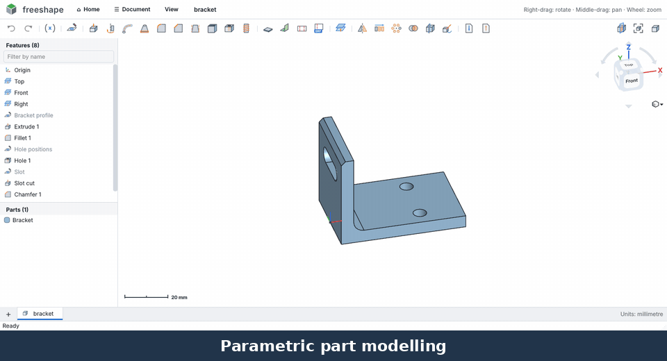
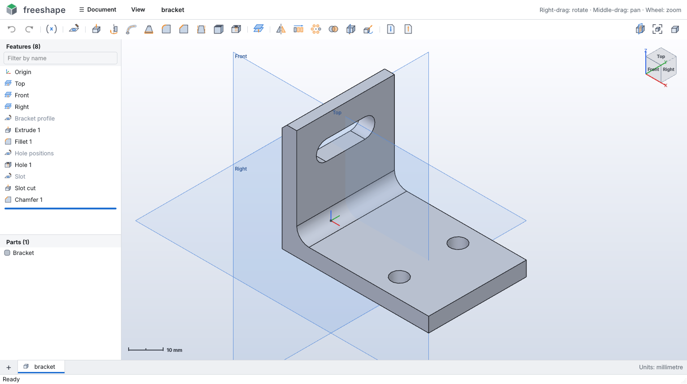
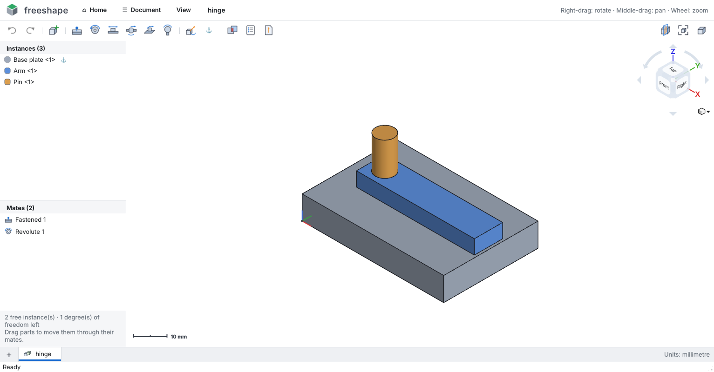
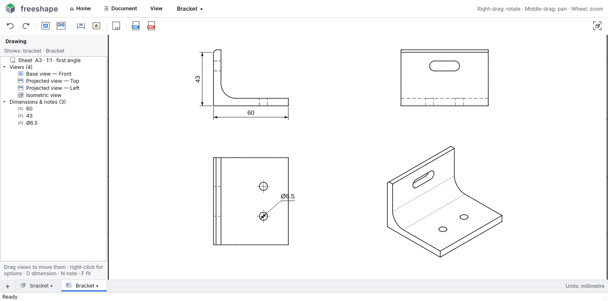
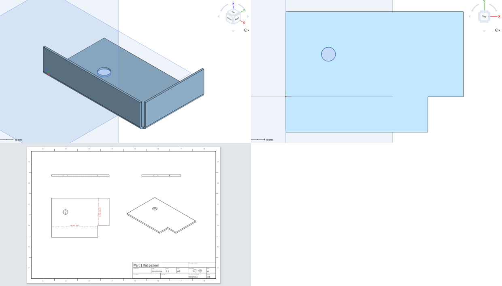

# FreeShape

**A free, offline, Onshape-style parametric CAD program for Windows (and Linux).** Sketch, model, assemble,
make 2D drawings and sheet-metal flat patterns — all on your own computer, no cloud and no account.

Geometry is real B-rep solid modelling on the OpenCascade kernel (the same open-source kernel FreeCAD uses),
so exports are proper STEP solids, and drawings / flat patterns export to DXF for AutoCAD and laser cutting.



## Why I made it

I use Onshape and like how it works — the feature list, the sketcher, the way assemblies and drawings just make
sense. But it's cloud-only, needs an account and an internet connection, and the free plan makes your designs
public. The free desktop alternative, FreeCAD, is powerful but I find it awful to use: confusing workbenches,
fiddly sketching and a steep learning curve for simple jobs.

I wanted something in between: a CAD program that **works like Onshape** but **runs locally**, is **free**, and
does the everyday engineering jobs I actually need —

- design parts for **3D printing** (export STL for the slicer, or STEP),
- bring in **STEP models** of PCBs and bought-in parts and design around them,
- put parts together in **assemblies** with proper mates,
- make **2D drawings** with real dimensions that open in **AutoCAD LT**,
- design **sheet metal** brackets and enclosures and get **flat-pattern DXFs** for laser cutting.

So I built FreeShape (with a lot of help from Claude, an AI assistant), iterating on it daily while using it on
real parts.

## What it does

- **Part Studios** — sketches with constraints and dimensions; extrude, revolve, sweep, loft, fillet, chamfer,
  shell, draft, holes (ISO clearance / tapped / counterbore / countersink), real modelled ISO threads, patterns,
  mirror, booleans, split, variables; rollback bar; STEP import with colours.
- **Assemblies** — insert parts (linked to their Part Studios), fastened / revolute / slider / cylindrical /
  planar / ball mates, drag parts through their mates, an Onshape-style move / rotate triad, interference check,
  bill of materials, STEP export with structure.
- **Drawings** — first or third angle views with hidden-line removal, projected and isometric views,
  dimensions that follow the model, notes, title block; export **DXF with real AutoCAD dimensions** and PDF.
- **Sheet metal** — flanges, exact flat patterns (K-factor), automatic corner reliefs, flat-pattern DXF with
  bend lines.
- **Feels like Onshape** — view cube, home page with recent projects, mouse controls, dark / light theme,
  autosave and crash recovery, a Windows installer with file icons.

| Part Studio | Assemblies | Drawings | Sheet metal (folded and flat) |
|---|---|---|---|
|  |  |  |  |

## Install and run

**The easy way:** download from the [latest release](https://github.com/richiewillmott/FreeShape/releases/latest):

- **Windows:** `FreeShape-Setup-r8.exe` — run it and follow the installer (no Python needed). Windows SmartScreen
  may warn the first time because the installer isn't code-signed yet: click **More info → Run anyway**.
- **Linux:** `FreeShape-r8-x86_64.AppImage` — make it executable and run it (no Python needed):
  `chmod +x FreeShape-r8-x86_64.AppImage && ./FreeShape-r8-x86_64.AppImage`
  (or right-click → Properties → "Allow executing as program", then double-click). Needs a 2024-or-newer
  distro (Ubuntu 24.04+, Fedora 40+, Mint 22+, Debian 13+, Arch …). If it says FUSE is missing, run it with
  `--appimage-extract-and-run`, or install `libfuse2` (Ubuntu: `sudo apt install libfuse2t64`).

### From source

You need Python 3.10–3.13 (64-bit) from https://www.python.org. On Windows, tick "Add python.exe to PATH" when installing.

Then just start it — **the first run installs everything automatically**:

- **Windows:** double-click `run_freeshape.bat`
- **Mac / Linux:** run `./run_freeshape.sh` (or `python3 start.py`)

The first start creates a private `.venv` folder next to the app and downloads OpenCascade, Qt and the
other requirements (about 300 MB, a few minutes). After that it opens straight away. To open a file:
`python start.py examples/bracket.fshape`. To reinstall from scratch, delete the `.venv` folder.

If you'd rather manage it yourself: `pip install -r requirements.txt` then `python -m freeshape`.

### Make a Windows program (.exe)

Double-click **`build_exe.bat`** (Windows). It uses the same Python setup, then packs everything — OpenCascade,
Qt, the logo and icons — into **`dist\FreeShape\FreeShape.exe`**, which runs on any 64-bit Windows PC without
Python. It also makes **`dist\FreeShape-portable-r8.zip`** (unzip anywhere and run). If
[Inno Setup](https://jrsoftware.org/isdl.php) (free) is installed it also builds **`dist\FreeShape-Setup-r8.exe`**,
a normal installer with Start-menu and desktop shortcuts, FreeShape icons on `.fshape` / `.fasm` files
(double-click to open them) and FreeShape in "Open with" for STEP files. The first build takes 5–10 minutes;
the app folder is large (about 1 GB, mostly the geometry engine), the installer much smaller.

### Make a Linux AppImage

On Linux, with the requirements and PyInstaller installed (`python3 -m pip install -r requirements.txt pyinstaller`),
run **`bash packaging/linux/build_appimage.sh`**. It packs FreeShape, checks the packed app with its self-test and
makes **`dist/FreeShape-r8-x86_64.AppImage`** (about 200 MB). An AppImage runs on Linux systems at least as new as the
one it was built on, so build on the oldest distro you want to support.

## Home page

FreeShape opens on a home page: start a new Part Studio or Assembly, open a file, import a STEP, or click one of
your **recent** projects — each card shows a picture of the model, where it's saved, when you last had it open and
its size. Search the list, right-click a card to show it in its folder or remove it, or drag files onto the window.
The **⌂ Home** button at the top goes back to it (and back to your work again).

## How it works (if you know Onshape, you already know this)

**Navigation** — right-drag to rotate (around the point under the cursor, or the centre of the model when you
start over empty space — a small blue marker shows the centre of rotation; View → *Rotate around* can make it
always the model centre or always the origin), middle-drag or Ctrl+right-drag to pan, wheel to zoom at the cursor. The view cube works like Onshape's: click a face, edge or corner for that view, the arrows turn the view 90°, the curved arrows roll it, and ▾ lists the named views. `F` zooms to fit,
`Shift+1…7` = Front, Back, Left, Right, Top, Bottom, Isometric.

**Selecting** — hover pre-highlights faces, edges, sketch regions and planes; click to add to the
selection, click empty space to clear. With one or two things selected, the bottom-right shows area,
length, radius or the minimum distance between them.

**Sketching** — select a plane or flat face (or not — the dialog will ask) and press **Sketch** (`Shift+S`).
The view turns to face the sketch plane.

| Tool | Key | Notes |
|---|---|---|
| Line | `L` | click-click; lines chain until `Esc` or you click an existing point |
| Corner / centre rectangle | `R` | adds horizontal/vertical constraints automatically |
| Circle | `C` | centre, then radius |
| 3-point arc / centre-point arc | `A` | |
| Point | `P` | used for hole centres |
| Construction toggle | `Q` | toggles selected geometry, or the mode for new geometry |
| Dimension | `D` | click a line (length), circle (Ø), arc (R), two points (distance — horizontal/vertical depending on where you place it), point + line, or two lines (distance or angle). You can also click a **part's edge or corner** to dimension to it, like Onshape. Type the value; expressions and units work: `25/2`, `1 in`, `10 cm` |
| Constraints | `I` `H` `V` `E` `T` | coincident, horizontal, vertical, equal, tangent; plus parallel, perpendicular, midpoint, concentric, fix on the toolbar. Select geometry then click the constraint, or click the constraint then the geometry |
| Use (project) | `U` | project part edges into the sketch (edges seen side-on, like a cylinder's rim, become straight lines) |
| Trim | | removes a line segment up to its intersections |
| Sketch fillet | | click a corner where two lines meet, type the radius — the shape keeps its dimensions |
| Offset | `O` | click a line, arc or circle to offset its whole connected outline; type the distance (negative = inside) |
| Slot | | click the two end centres, type the width |
| Mirror | | select geometry, then click the line to mirror about — the copy stays linked to the original |
| Linear / circular pattern | | select geometry, then click a direction line (copies go towards where you click) or a centre point; type the count and spacing / angle |

**Typing sizes as you draw:** right after you finish a line, rectangle, circle or arc, a dimension box pops up — type a value (e.g. `25`, `1/2 in`) and press Enter and the shape snaps to it. For a rectangle you get width, then height. Just keep drawing (or press Esc) to skip it.

Drawing snaps to existing points and curves (adding coincident constraints) and infers horizontal/vertical.
Geometry is **blue while under-defined and black when fully defined**; conflicting constraints turn red.
Drag points or curves with the select tool and everything constrained follows. Double-click a dimension to
edit it. `Del` deletes, `Ctrl+Z` undoes inside the sketch. Closed areas become shaded **regions** — overlapping
shapes give separate regions, exactly like Onshape.

**Variables** — the **(x)** button defines a named value, e.g. `#wall = 3`. Type `#wall` (or `#wall * 2 + 1`) in any
dimension or feature field; edit the variable later and everything that uses it updates. Variables appear in the
feature list, so you can define them part-way through and use them in later features.

**Part features** — each opens a floating dialog with a live preview; ✓ (Enter) accepts, ✕ (Esc) cancels.
Things selected before opening a feature are pre-filled. Extrude and Plane show a **blue arrow you can drag** to set the depth/offset (drag back past the start to flip direction; hold Shift for finer, unsnapped values).

- **Extrude** — New / Add / Remove / Intersect; Blind, Symmetric, Through all; second direction. Cuts
  automatically go into the material.
- **Revolve** — around a sketch line, a part edge, or the X/Y/Z axis; full, one direction or symmetric.
- **Fillet / Chamfer** — pick edges, or a face to do all its edges.
- **Shell** — pick faces to remove, inward or outward.
- **Hole** — at the points and circle centres of a sketch (click the sketch, or pick it in the dialog);
  "Size of the sketch circles" makes each hole the size you drew it, or use ISO clearance (close / normal / loose fit), ISO tapped (M2–M12, sized to the
  tap drill), or a custom size; simple, counterbored or countersunk; through or blind with a drill point.
- **Thread** — real, modelled ISO metric threads (M1.6–M24, coarse pitch) on any round face: pick a hole to tap
  it (internal thread) or a shaft to thread it (external). The size is detected from the diameter (a Ø5 hole →
  M6, a Ø6 shaft → M6), or choose it, or set a custom diameter and pitch. Whole face or a set length, left-hand,
  and a *print clearance* for 3D-printed threads (0.1–0.2 mm usually works). Tapped holes can also be modelled
  straight from the Hole feature (*Model the thread*). Real threads take a few seconds to build, so plain tapped
  holes (sized for the tap drill) stay the default — like Onshape.
- **Sweep** — a profile along a path (connected sketch curves or part edges), e.g. pipes and handles.
- **Loft** — blend between two or more profiles on different planes; tick *Straight sides* for a ruled loft.
- **Draft** — tilt faces by an angle from a neutral plane, for moulded or 3D-printed parts.
- **Split** — cut parts in two with a plane or flat face; keep both sides or one.
- **Move** — move and/or rotate parts (or imports), optionally keeping the original as a copy.
- **Plane** — offset from a plane or planar face.
- **Mirror**, **Linear pattern**, **Circular pattern** — of parts.
- **Boolean** — union, subtract, intersect parts.
- **Import STEP** and **Export STEP / STL** (whole studio or one part from the Parts list).

**Feature list** — double-click to edit any feature; the model rolls back while you edit and everything
after it regenerates when you accept. Right-click for rename, suppress, roll to here, hide/show, delete.
Drag the blue **rollback bar** to see the model at any point in history; new features are inserted at the bar.
Features that fail to regenerate turn red — hover them for the reason. Hover or click a feature to see what it
made highlighted on the model (its faces, or a sketch's curves), like Onshape.

**Parts list** — right-click for rename, colour, hide/isolate, mass properties and per-part export.

**Measure** — select anything and its size shows bottom-right: face area, edge length and radius, part volume,
mass and centre of mass. Select two things for the minimum distance, the X/Y/Z offsets, and the angle between them.

**Section view** — the section button (or Ctrl+Shift+X) slices the model so you can see inside. Pick the Top / Front /
Right plane, or select a face first to cut exactly there; drag the slider or type an offset, and tick *Flip* for the
other side.

**Big imports** — large STEP files are read in the background with a progress window (and a Cancel button), so
FreeShape doesn't freeze while it works; the view stays quick even with hundreds of parts.

**Imported colours** — STEP files keep their part names and colours, including models where only some faces are
coloured; the colours stay on those faces after later features like fillets and cuts.

**Autosave and recovery** — open documents are saved in the background every minute. If FreeShape closes
unexpectedly, the next start offers to bring back your unsaved work. (Running two FreeShape windows at once is fine.)

**Dark mode** — View → Theme. **Shiny surfaces** (Onshape-style highlights) — View → Shiny surfaces. **Recent files** — Document → Open recent.

## Assemblies

Click **+** at the bottom left and choose **Create Assembly** (or Document → New Assembly, Ctrl+Shift+N). An assembly
tab puts parts together and lets them move the way the real thing would — like Onshape's Assembly tab.

- **Insert** (`I`) — pick parts from any open Part Studio tab (or a whole Part Studio at once), or from a `.fshape`
  or STEP file. Parts from Part Studios stay **linked**: change the part in its tab and the assembly updates when
  you come back to it. The first part inserted is **fixed** (⚓); everything else can move.
- **Drag** a part with the left mouse button to move it. Mated parts move only the way their mates allow — drag
  the arm of a hinge and it swings round the pin. If nothing in a mated group is fixed, the whole group slides.
- **Move / rotate triad** — click a part and a triad appears where you clicked, like Onshape's: drag an **arrow**
  to slide along that axis, the **ring** at its end to turn about that axis (hold Shift for 15° steps), a
  **square** to slide in that plane, or the **ball** to move freely. The distance or angle shows while you drag —
  just type a number and press Enter to set it exactly (no need to click the box). Mates still apply (a hinged part turns about its hinge). Esc or a
  click on empty space hides it.
- **Mates** — pick a mate type, then click one thing on each part: a flat face, a round face (the end nearest
  your click), a circular edge (its centre) or a straight edge. The second part jumps into place, with a live
  preview; **Flip** turns it the other way round, **⟳ 90°** turns it a quarter, and there's an offset and angle.

  | Mate | Key | Motion left |
  |---|---|---|
  | Fastened | `Shift+F` | none |
  | Revolute | `Shift+R` | rotation about the axis |
  | Slider | `Shift+L` | sliding along the axis |
  | Cylindrical | | sliding and rotation along the axis |
  | Planar | | sliding and turning on the plane |
  | Ball | | rotation about a point |

  A mate that can't hold together with the others turns red and is left out, so the rest still works.
  Right-click mates to edit, suppress or delete them; selecting a mate shows its connectors in the view.
- **Instances** — right-click for rename, fix / unfix, hide, isolate, colour, **Move / rotate** by exact amounts,
  duplicate, open its Part Studio, mass properties and the degrees of freedom it has left.
- **Interference check** — shows in red where parts overlap, with the overlap volume.
- **Bill of materials** — each different part with its quantity, volume and mass; copy it or save it as CSV.
- **Export** — STEP keeps the assembly structure, part names and colours; STL is one mesh.

Assemblies save as `.fasm`. The file links to the Part Studio files and also keeps a copy of every part, so it
still opens if a Part Studio file goes missing (it says so, and shows the saved copy). Try it with
`examples/hinge.fasm`.

**Tabs** — each tab along the bottom is a Part Studio or an Assembly. **Import STEP** and **Open** put the file in a new tab (or reuse the current tab if it's empty); **+** adds a new Part Studio or Assembly (Ctrl+N for a Part Studio). Drag tabs to reorder, double-click to rename, right-click for rename / duplicate / close, or middle-click / Ctrl+W to close. To bring a STEP into the model you're working on instead, use Document → *Import STEP into this tab*.

Part Studios save as `.fshape`, and older `.fcad` files still open (plain JSON of the feature history — imported STEP data is embedded).

## Sheet metal

1. Sketch the outline of the sheet (e.g. a rectangle), then **Sheet metal**: pick the region and set the
   thickness, inside bend radius and K-factor (0.44 is right for most steel and aluminium).
2. **Flange**: click the edges to bend up, set the length (measured to the outside of the bend) and angle.
   *Outside the edge* makes the part grow by the bend; *inside the edge* keeps the outline size. Tick *Bend the
   other way* to bend down. Flanges can go on the ends of other flanges.
3. Add holes and cut-outs with the normal tools (sketch on a face + extrude cut, or Hole).
4. **Flat pattern** shows it unfolded; **Export flat pattern (DXF)** gives the laser-cutting file: outline on
   layer CUT, dashed bend lines on layer BEND with "UP 90° R1.5" notes. Right-click the part for the same, or
   for a drawing of the flat pattern.

Where two bends meet at a corner, a **corner relief** (a square notch, 1.5 × thickness by default) is cut
automatically so the corner folds cleanly; turn it off or change its size in the Sheet metal feature.

The flat is exact: each bend uses *angle × (radius + K × thickness)* of sheet. Not yet: hems, jogs, rolled /
conical sheet, and cuts that cross a bend (they're left out of the flat).

## Drawings

Click **+** → **Create Drawing…** (or Document → New Drawing, or right-click a part → *Create drawing…*). Pick
what to draw — one part, every part in a Part Studio, or a whole Assembly — the sheet size (A4–A0), and the
projection: **first angle** (ISO / BS 8888, UK & Europe) or **third angle** (ANSI). FreeShape lays out the front,
plan, side and isometric views at the biggest standard scale that fits, with a border and a title block.

- **Views** are worked out from the 3D model with hidden-line removal: visible edges thick, hidden edges dashed,
  centre marks on holes (hidden edges start off on very busy views like gears — right-click a view to show
  them). Complex parts show a quick version first while the exact views are worked out. **Insert view** adds another (front / top / side / back / bottom / isometric, any scale);
  **Projected view** — pick a view, then click beside it for the view from that side (off a corner gives an
  isometric). Projected views stay lined up with the view they came from; drag views to move them.
- **Dimension** (`D`): click an edge then empty space for its length, two parallel edges for the distance
  between them (a cylinder's two outline edges give its Ø), a hole's edge for its Ø (an arc gives R), or two
  points — corners or hole centres — or a point and an edge; then click where the dimension goes (above/below for
  horizontal, left/right for vertical). Double-click one to add text before/after it (e.g. `4× `, ` THRU`),
  set decimal places, or change its direction.
- **Dimensions follow the model**: change the part in its Part Studio and the drawing updates with the new
  sizes when you come back to it. If an edge disappears, its dimension turns red.
- **Notes** (`N`), and **Sheet** for the size, scale, projection and title block (title, drawing number,
  revision, drawn by, date, company, material, general tolerances).
- **Export DXF** — AutoCAD DXF with real AutoCAD dimensions (grip-edit or restyle them in AutoCAD), Arial
  text and layers (VISIBLE, HIDDEN, CENTER, DIM, NOTE, BORDER, TITLE …), at paper size or with the views at
  true 1:1 size. **Export PDF** — vector, at the exact sheet size, ready to print.

Drawings save as `.fdwg` and keep a copy of the model, so they still open if the Part Studio is missing.

## Scripting

Everything the UI does goes through a small Python API, so models can be generated from code.
See `examples/make_bracket.py`.

## Honest limits

This is a capable hobby/prototyping tool, not a replacement for Onshape:

- **No FeatureScript.** Sheet metal covers flanges, corner reliefs and flat patterns, not hems or jogs. Assemblies are one level deep (no sub-assemblies yet), and
  there are no gear / rack / screw relations, mate limits or exploded views.
- Drawings have no section, detail or broken views, angle dimensions, hole tables, GD&T or multiple sheets yet.
- **No real-time collaboration, branching or cloud storage** (it is deliberately local).
- **Reference tracking is geometric**: after an upstream edit, later features re-find their faces, edges and
  regions by position and shape. That handles resizing and most edits well, but a drastic topology change can
  make a later feature lose its reference (it turns red and you re-pick it). Onshape's persistent naming is
  more robust here.
- The sketch solver is a numerical least-squares solver: it is fine for typical sketches (tens of entities),
  not for huge ones.
- Default units are millimetres.

## Layout

```
freeshape/
  kernel.py      OpenCascade wrappers: extrude, revolve, booleans, fillet, shell, regions, tessellation, STEP/STL
  sketch.py      sketch model + constraint solver
  sketch_ops.py  sketch fillet, offset, slot, mirror and patterns
  expr.py        numbers with units, expressions and #variables
  measure.py     measurements between faces, edges and parts
  features.py    feature implementations and reference re-finding
  document.py    feature list, rollback, cached regeneration, undo/redo, save/load
  drawing.py     2D drawings: views (hidden-line removal), dimensions, title block, DXF export
  sheetmetal.py  sheet metal: panels and bends, flanges, exact flat patterns, flat-pattern DXF
  dxf.py         a small DXF (AutoCAD R12) writer
  assembly.py    assemblies: instances, mate connectors, the mate solver, interference, BOM, .fasm files
  ui/            Qt interface: viewport (OpenGL), sketcher, feature dialogs, panels, main window
tests/               headless tests (python -m pytest tests)
examples/            example documents (bracket, hinge assembly) and the scripts that build them
```

## Licence

FreeShape is free software: you can redistribute it and/or modify it under the terms of the
**GNU General Public License version 3** (or any later version) — see [LICENSE](LICENSE).
In short: use it for anything, share it, change it — and if you share a changed version, share its source code
under the GPL too.

Copyright © 2026 Richard Willmott.

It is built on open-source libraries — notably the OpenCascade geometry kernel (LGPL) and Qt / PySide6
(LGPL); see [THIRD-PARTY-NOTICES.txt](THIRD-PARTY-NOTICES.txt).
