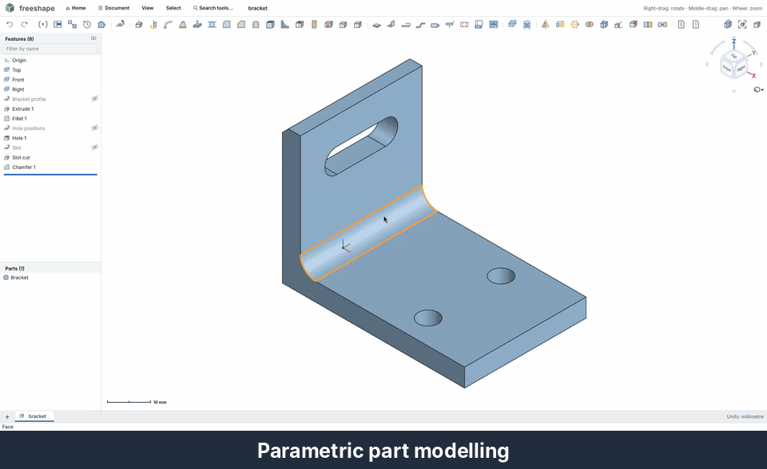
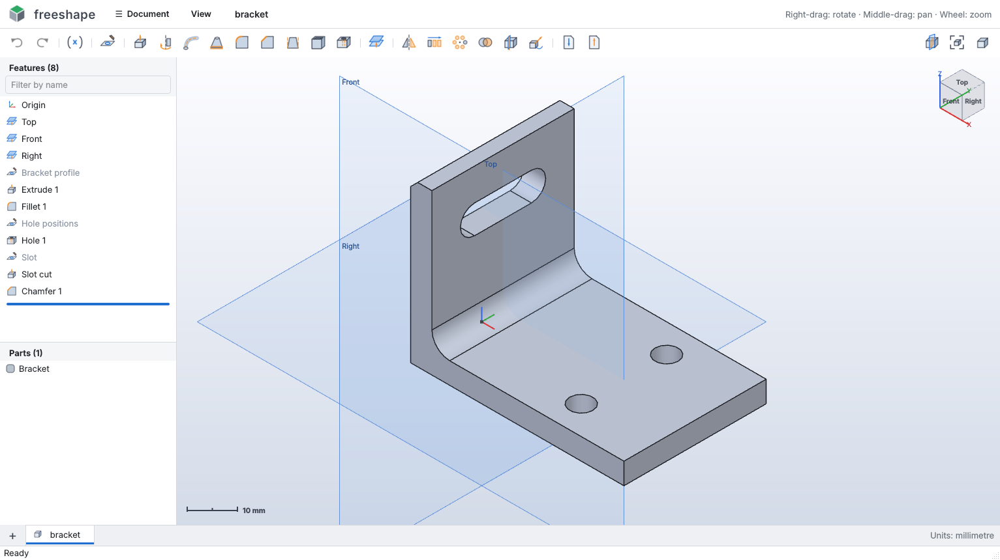
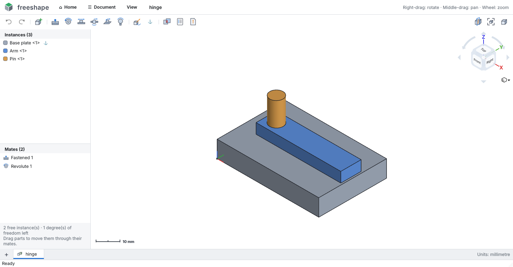
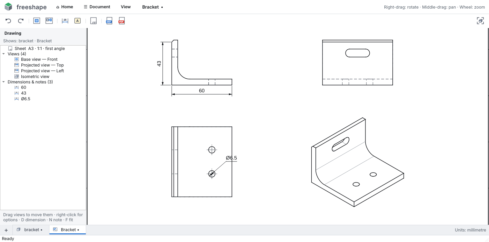
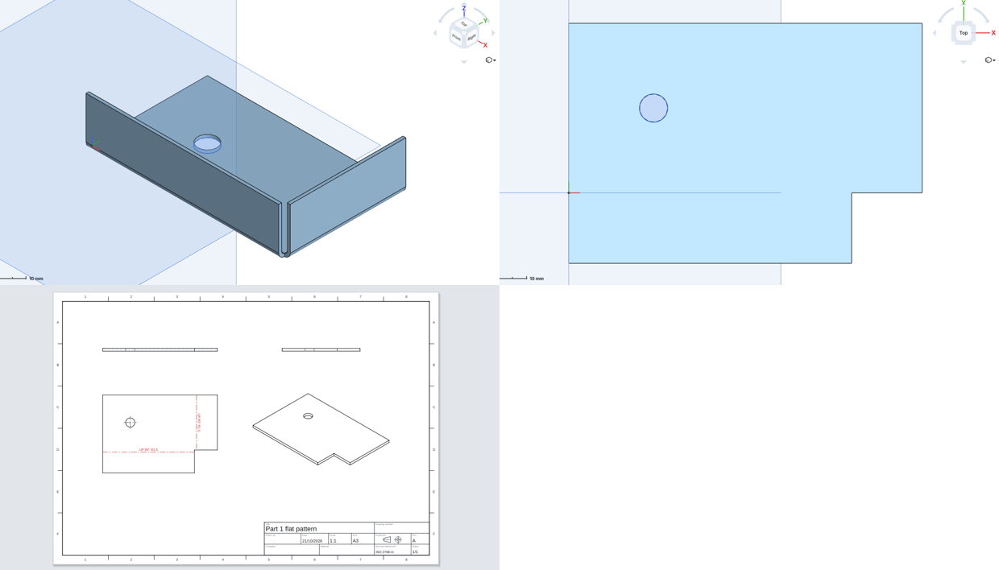

# FreeShape

**Parametric CAD that works like Onshape, but free, offline and yours.** Windows, Mac and Linux. No cloud, no
account, no public-by-default designs.

**[⬇ Download the latest release](https://github.com/richiewillmott/FreeShape/releases/latest)** · [User guide](docs/USER_GUIDE.md) · [What's new](CHANGES.md)

## Why

Onshape is great to use but cloud-only. FreeCAD is free and local but hard to love. FreeShape sits in between:
the Onshape workflow — feature list, sketcher, mates, drawings — running on your own computer, on the same
OpenCascade kernel FreeCAD uses, so you get real B-rep solids and proper STEP files.

## What you can do

- **Part Studios** — constrained sketches; extrude, revolve, sweep and loft as solids, surfaces or thin walls;
  fillets, chamfers, shell, draft, holes and real ISO threads; patterns, mirror, booleans, split; variables with
  units, and variables *measured from the model* that follow every change.
- **Assemblies** — Onshape-style mates, gear / rack / screw relations, a standard parts library (ISO screws, nuts,
  bearings), exploded views, interference check and bill of materials.
- **Drawings** — projected, section and detail views, dimensions that follow the model, parts lists and balloons;
  export **PDF** or **DXF with real AutoCAD dimensions**.
- **Sheet metal** — flanges, hems, jogs and tabs, exact flat patterns with bend lines, and nesting on stock
  sheets for laser cutting.
- **Configurations, derived parts and version history** — many sizes from one table, and a readable *what
  changed* between any two versions, shown in 3D.
- **Import and export** — STEP (with colours, fast even with hundreds of parts), STL for 3D printing, BREP.
- **Plugins** — ready-made Gridfinity bins, timing pulleys, gears, Lighten pockets, laser-cut boxes and batch
  export, or write your own in Python ([PLUGINS.md](PLUGINS.md)).

| Part Studio | Assemblies | Drawings | Sheet metal |
|---|---|---|---|
|  |  |  |  |

## New in 2.2

- **Thicken, Enclose, Rib, Helix, Delete part and Bounding box** from Onshape's feature menu.
- **Variables measured from the model** — distance, angle, area, volume and more, re-measured on every rebuild.
  Select something and press **(x)**.
- **Compound** (from SALOME) — solids that share the faces where they touch, for conformal meshing.
- **Surfaces from crossing curves** — a + or a T extrudes into one surface per arm, where Onshape errors.
- **Onshape's view options** — perspective, translucent, hidden edges, named views and more.

Full history in [CHANGES.md](CHANGES.md).

## Install

Grab the file for your system from the [latest release](https://github.com/richiewillmott/FreeShape/releases/latest):

| | File | First run |
|---|---|---|
| **Windows** | `FreeShape-Setup-<version>.exe` (or the portable zip) | SmartScreen warning: **More info → Run anyway** |
| **Mac** (Apple Silicon) | `FreeShape-<version>-mac-arm64.dmg` | Drag to Applications, then right-click → **Open** |
| **Linux** | `FreeShape-<version>-x86_64.AppImage` | `chmod +x` it and run; or `am -i freeshape` |

The installers aren't code-signed yet, hence the warnings. If the AppImage says FUSE is missing, run it with
`--appimage-extract-and-run` or install `libfuse2`. To run from source or build it yourself, see
[BUILDING.md](BUILDING.md).

## Know Onshape? You already know FreeShape

Right-drag rotates, middle-drag pans, the wheel zooms. Select a plane and press `Shift+S` to sketch; `L`, `R`,
`C`, `D` draw lines, rectangles, circles and dimensions. Double-click any feature to edit it, and drag the
rollback bar through history. Type `#name` in any box to use a variable.

Everything else — every tool, key and option — is in the **[user guide](docs/USER_GUIDE.md)**. Option-by-option
progress against Onshape is tracked in [FEATURE_PARITY.md](FEATURE_PARITY.md).

## Honest limits

FreeShape is a capable tool for hobby, prototyping and small-business work, not a drop-in Onshape replacement:
no FeatureScript (Python plugins instead), no sub-assemblies yet, no real-time collaboration or cloud (on
purpose), and references are re-found by geometry, so a drastic upstream change can occasionally make a later
feature need re-picking. The full list is in the [user guide](docs/USER_GUIDE.md#honest-limits).

## Licence

Free software under the **GNU GPL v3** — use it for anything, share it, change it; if you share a changed version,
share its source too. See [LICENSE](LICENSE). Built on OpenCascade and Qt / PySide6
([THIRD-PARTY-NOTICES.txt](THIRD-PARTY-NOTICES.txt)).

Copyright © 2026 Richard Willmott. Made with a lot of help from Claude.
